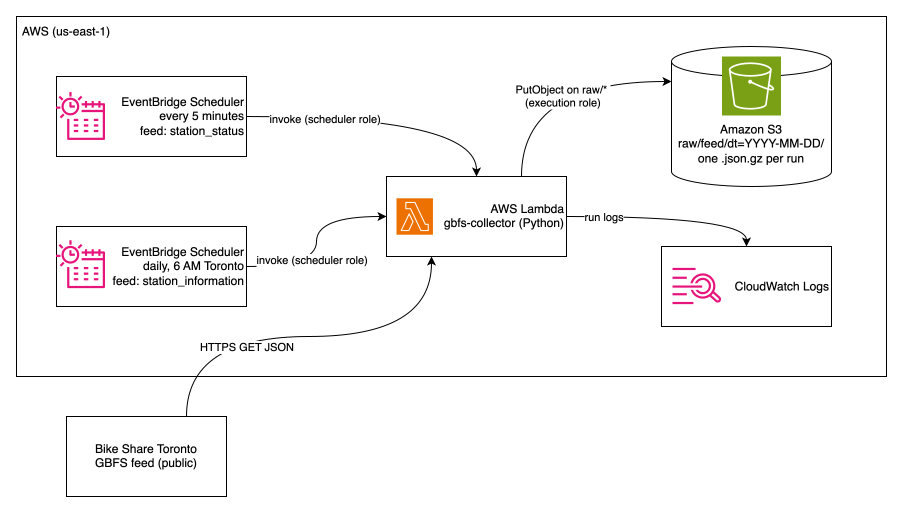

# Toronto Bike Share GBFS Collector
 
A small serverless collector that snapshots Toronto Bike Share's live station data every 5 minutes and stores the raw responses in Amazon S3. The data feeds my warehouse and lakehouse projects.

## Architecture
 
<p align="center">
  
</p>


## What it collects

| Feed | Contents | Frequency | Size per file (gzipped) |
| --- | --- | --- | --- |
| `station_status` | Bikes and docks available at each station | Every 5 minutes | ~12 KB |
| `station_information` | Station names, coordinates, capacity | Daily at 6 AM EST time | ~69 KB |
 
Collection window: October 5 to October 31, 2026 (about 7,700 status snapshots).

## S3 layout

```
s3://<bucket>/
  raw/
    station_status/
      dt=2026-10-05/
        station_status_20261005T161745Z.json.gz
    station_information/
      dt=2026-10-05/
        station_information_20261005T161955Z.json.gz
```
 
- `raw/` holds the feed exactly as we receive it - any changes to this data will be stored separately later. 
- `dt=YYYY-MM-DD` organizes the files by date. Will make it easier later for Glue and Athena to find and query data for a speciic day w/o having to scan all the files.
- All timestamps are UTC - will help keep the data consistent and will prevent missing or duplicate timestamps when daylight sving time changes. 

## Workflow

`lambda_function.py` does four things on each run:
 
1. Reads the feed name from the event (`{"feed": "station_status"}`).
2. Downloads that feed from the GBFS endpoint.
3. Gzips the raw bytes and uploads them to S3.
4. Checks the feed's `last_updated` field and logs a warning if the data is more than 10 minutes old, which catches a frozen feed that still returns 200.

## Setup
 
Built in the AWS console:
 
1. **S3:** create a bucket with Block Public Access on.
2. **Lambda:** Python 3.14, 128 MB memory, 15 second timeout, no VPC. Set the environment variable `BUCKET_NAME`.
3. **IAM:** add the inline policy in [`lambda-s3-policy.json`](lambda-s3-policy.json) to the function's execution role, with your bucket name.
4. **EventBridge Scheduler:** two schedules targeting the function:
   - `rate(5 minutes)` with payload `{"feed": "station_status"}`
   - `cron(0 6 * * ? *)`, America/Toronto, with payload `{"feed": "station_information"}`
5. **CloudWatch Logs:** Lambda automatically creates a log group for the function. The logs show when a feed is collected, where it was saved in S3, the file size, and any errors or stale-feed warnings. These logs can be used to check that the Lambda is running successfully or not. 

## Data source
 
Live data from the Toronto Bike Share GBFS feed, listed on [Toronto Open Data](https://open.toronto.ca/dataset/bike-share-toronto/).

